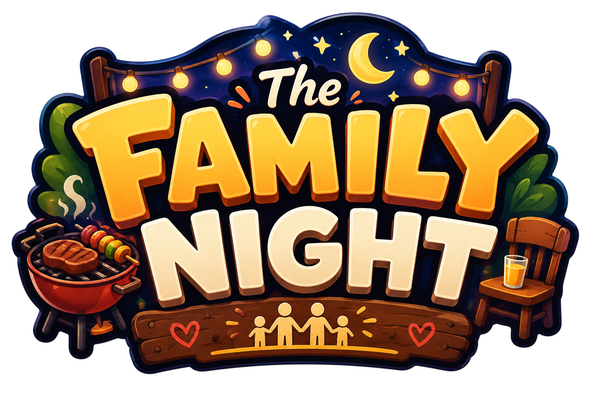
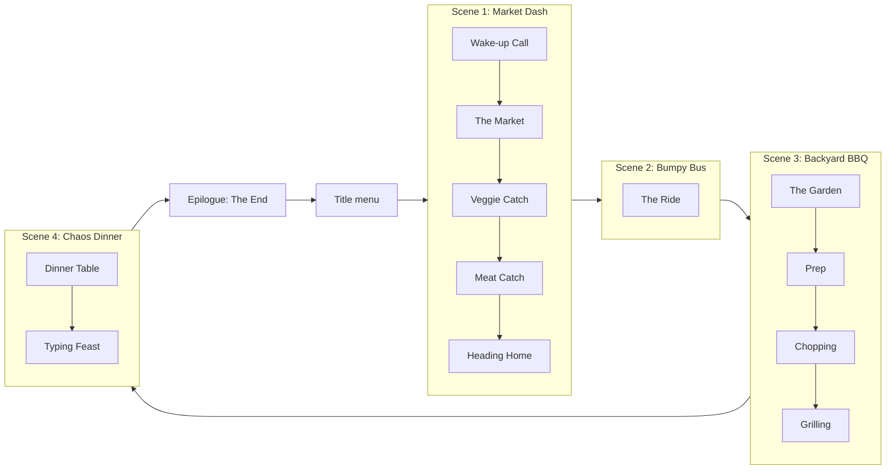
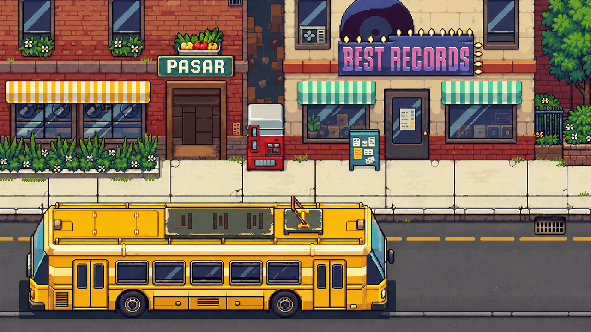
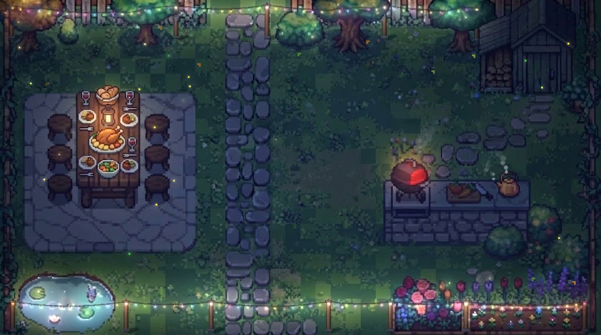
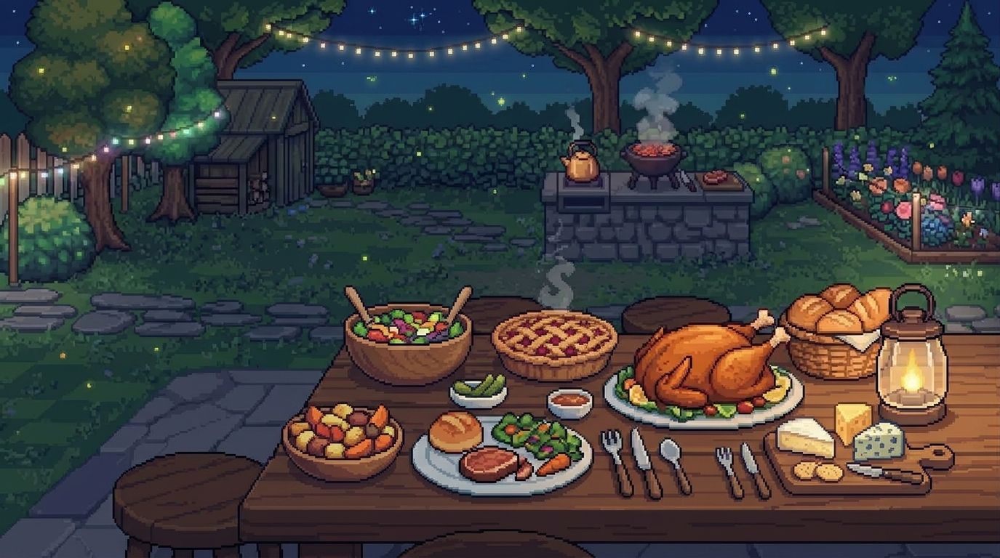
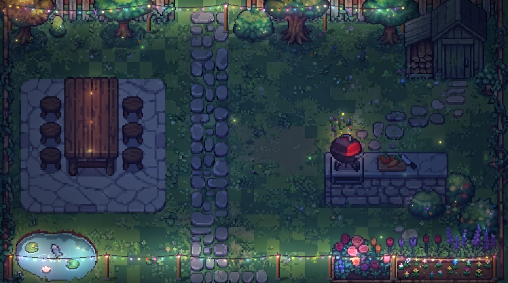

<p align="center">
  
</p>

<h3 align="center">One Saturday. One shopping list. One very chaotic family dinner.</h3>

<p align="center">
  A story-driven arcade adventure in Python, built on <a href="https://api.arcade.academy/">Arcade</a>.<br>
  Four scenes, eleven chapters, eight mini games and a typing showdown with a table full of leftovers.
</p>

<p align="center">
  
  
  
  
  
</p>

<p align="center">
  <a href="#quick-start">Quick start</a> ·
  <a href="#the-story">The story</a> ·
  <a href="#controls">Controls</a> ·
  <a href="#achievements">Achievements</a> ·
  <a href="#under-the-hood">Under the hood</a> ·
  <a href="#project-layout">Project layout</a> ·
  <a href="#the-team">Team</a>
</p>

---

## Table of contents

- [Quick start](#quick-start)
- [The story](#the-story)
  - [Scene 1: Market Dash](#scene-1-market-dash)
  - [Scene 2: Bumpy Bus](#scene-2-bumpy-bus)
  - [Scene 3: Backyard BBQ](#scene-3-backyard-bbq)
  - [Scene 4: Chaos Dinner](#scene-4-chaos-dinner)
  - [Epilogue](#epilogue)
- [Menus and meta features](#menus-and-meta-features)
- [Controls](#controls)
- [Achievements](#achievements)
- [Command line options](#command-line-options)
- [Developer test menu](#developer-test-menu)
- [Running the tests](#running-the-tests)
- [Under the hood](#under-the-hood)
- [Project layout](#project-layout)
- [Adding a new scene or chapter](#adding-a-new-scene-or-chapter)
- [Settings and save data](#settings-and-save-data)
- [Troubleshooting](#troubleshooting)
- [The team](#the-team)
- [Credits and licences](#credits-and-licences)

---

## Quick start

### Requirements

| Package | Needed for | Tested with |
|---|---|---|
| Python | everything | 3.12 |
| `arcade` | window, sprites, sound, shaders | 3.3.3 |
| `Pillow` | cutting out and drawing all art | 11.3 |
| `numpy` | image keying, post-processing | 2.5 |
| `scipy` | splitting characters into parts (`ndimage`) | 1.18 |
| `av` (PyAV) | *optional:* animated backgrounds and the ending video | 18.1 |

Without PyAV the game still runs. Every animated background falls back to its still image and the ending plays as a title fade over black.

### Install and play

```powershell
# from the repository root
py -3.12 -m pip install arcade pillow numpy scipy av
py -3.12 main.py --windowed
```

Leave out `--windowed` to start in fullscreen. The window is resizable either way.

> **First launch is slower.** Characters are cut out of their source art, rimmed and scaled, then baked to `assets/.cache/`. Every launch after that reads the baked files back, so the menu opens straight away.

---

## The story

Terry gets a phone call early on a Saturday. Cousin Dave's family is coming over tonight, and somebody has to buy the food, carry it home, cook it and survive dinner. That somebody is Terry.



| | | |
|:---:|:---:|:---:|
| <br>**Market Dash** | <br>**Bumpy Bus** | <br>**Backyard BBQ** |
| <br>**Chaos Dinner** | <br>**Typing Feast** | <br>**Epilogue** |

### Scene 1: Market Dash

*A Saturday morning call sends Terry racing to the market.*

| Chapter | What happens |
|---|---|
| **Wake-up Call** | An illustrated story intro. The phone rings, Terry answers in a panic, and the day starts. |
| **The Market** | Walk the crowded market floor and find the stalls. |
| **Veggie Catch** | Move left and right to catch falling vegetables before the snatchers grab them. |
| **Meat Catch** | Same rush, now at the meat stall. Lose and you get a *Try Again / Give Up* choice. |
| **Heading Home** | Shopping done. Wave goodbye and head for the bus. |

### Scene 2: Bumpy Bus

*Keep the shopping safe on a rough ride home.*

Board the bus at the station (A/D to walk, Space to jump, Enter beside the bus to board). The ride lasts **90 seconds** and asks you to do two things at once:

**1. React to bus events.** Events appear in random order at random intervals. The central **ALERT** shows the event name, a random response letter, how many presses it needs and a countdown. The letter changes every time and the warning icons carry no fixed key labels, so you have to read the alert.

**2. Track the ring with your mouse.** The mouse target alternates every 10 to 13 seconds between two rings, with a blue-white ripple and crossfade between them:

| Ring | Behaviour |
|---|---|
| **Pirate rag-doll** | Gives a short cannon warning, fires a cannonball, then spins and recoils 260 to 340 canvas pixels to a new spot (at least 240 near the edges). The ball is a visual cue only. |
| **Tesla coil** | Marks its destination, charges, stretches out of sight and reappears along an electric trail with a landing pulse and fading afterimage. The outside timer pauses while the ring cannot be tracked. |

Outside the ring the guide breathes red; inside it turns steady green. **Every five continuous seconds outside a visible ring costs one bread segment** of the three-segment health bar. The shopping on screen is eggs, meat, cabbage and eggplant. Space or P pauses everything (movement, lights, projectiles and damage) together. Arriving carries straight on to the BBQ.

### Scene 3: Backyard BBQ

*Get the garden ready and cook for the family.*

| Chapter | What happens |
|---|---|
| **The Garden** | The backyard hub. Walk around, talk to the family and pick up quests from the quest panel. |
| **Prep** | Lay the ingredients out on an animated prep table. |
| **Chopping** | Five ingredients in order: meat, carrots, onions, green peppers, eggplant. Click exactly on **CHOP**. Missing the food, chopping too fast or stalling all cost a heart, and ruining too much restarts the prep. |
| **Grilling** | Click **SPIN** when the arrow lands in the green zone and watch the temperature bar. Red zones and flare-ups add burn strikes; three strikes and the skewers are charcoal. |

### Scene 4: Chaos Dinner

*Night falls and the whole family sits down to eat.*

**Dinner Table.** Terry walks down the night garden path while the scene title drifts up over a blurred garden. Dave, Christine, Unc John, Jess and Tom are already there. Talk to anyone (Enter when the prompt appears), then start dinner at the table marked with **!**. The food fades on, the screen dips to black, and the family is seated and eating, with blinking, chewing and chatting faces.

**Kids at the table** (40 seconds). Jess and Tom keep hopping off their stools. Click a runaway and drag them back to the glowing box over their seat. They throw a tantrum the whole way, yanking your cursor aside, while an escape bar fills over their head. Drop them in the wrong place, or carry them until the bar fills, and they wriggle free. Keep them seated **75%** of the time to move on. A green *Dinner Saved!* or red *What a Mess!* card shows the result.

**Typing Feast** (60 seconds). Half an hour later the family is full and gone, and Terry is alone with the leftovers. A monkeytype-style typing game: every correct word is a bite. Type **36** correct words to clear the table, which empties a course at a time through five animated stages, with crumbs, a chomp and a line from Terry each time. Every ten clean words in a row plays a combo fanfare. Results show WPM, accuracy, a WPM graph across the round and whether the food got finished. **Tab** restarts.

### Epilogue

Terry has eaten until he is full. The camera tilts up from the cleared table into the night sky, the title fades in among the stars, and the game closes on black. Any key or click skips it; either way you land back on the title menu.

---

## Menus and meta features

The title menu has five buttons, plus a credits medallion in the corner.

| Menu | What it does |
|---|---|
| **Play** | Starts the story from the Market Dash. |
| **Story** | Chapter select. Scenes run down the left, the chosen chapter fills a big preview on the right, and a thumbnail strip skips between chapters. The preview washes the whole screen and crossfades as you move. Up/Down picks a scene, Left/Right a chapter, the number key jumps to a scene, Enter plays. |
| **Achievement** | Every scene's achievements with a total progress bar on top and per-scene counts on the left. Hidden achievements read `???` until earned. |
| **Settings** | Master, sound and music volume, plus the graphics mode (`quality` plays animated backgrounds; `performance` uses still images). Changes apply on the next sound and the next frame. |
| **Quit** | Closes the game. |

In every scene, **Esc** opens a pause overlay (resume, settings, main menu) while the scene keeps drawing underneath. The dinner scene also has a HUD with a day-cycle badge, settings, backpack and map.

---

## Controls

| Where | Keys and mouse |
|---|---|
| **Everywhere** | `Esc` pause / back · `Enter` or `Space` advance dialogue |
| **Walking scenes** (market, garden, dinner) | `W` `A` `S` `D` move · `Space` jump · `Enter` interact when the prompt shows |
| **Market catch games** | `A` / `D` or `←` / `→` move |
| **Bus station** | `A` / `D` move · `Space` jump · `Enter` beside the bus to board |
| **Bus ride** | Mouse tracks the ring · alert letter keys respond to events · `Space` or `P` pause |
| **Chopping / Grilling** | Mouse: click **CHOP** / **SPIN** |
| **Kids at the table** | Mouse: click and drag a kid back to their seat |
| **Typing Feast** | Type the words · `Enter` to start · `Tab` restart |
| **Title cards and intros** | `Space` skip |
| **Ending** | Any key or click skips |

---

## Achievements

Achievements are saved the moment they unlock and announced with a popup that draws over whatever scene is on screen. Scenes can call `achievements.unlock(key)` every frame the condition holds; only the first call counts.

| Achievement | How to earn it |
|---|---|
| **Family Reunion** | Talk to everyone in the garden before dinner. |
| **Seat Patrol** | Keep Tom and Jess seated long enough to pass. |
| **Glued to Their Seats** | Keep the kids seated 95% of the time. |
| **Chaos Dinner** | Finish the leftover feast to close the scene. |
| **Table Cleared** | Eat every leftover before the clock runs out. |
| **Speed Eater** | Reach 60 WPM in the leftover feast. |
| **Clean Plate** | Clear the table with 100% accuracy. |
| **On a Roll** | Type 20 words in a row without a mistake. |
| *Hidden x3* | Three secret achievements. Find them yourself (or read `ACHIEVEMENTS` in `game/config.py` if you must). |

---

## Command line options

```powershell
py -3.12 main.py [--windowed] [--market | --bus | --bbq | --feast] [--screenshot out.png]
```

| Flag | Effect |
|---|---|
| `--windowed` | Start in a window instead of fullscreen. |
| `--market` | Skip the menu, open Scene 1. |
| `--bus` | Skip the menu, open the bus station (Scene 2). |
| `--bbq` / `--after-bus` | Skip the menu, open the garden hub (Scene 3) already faded in. |
| `--feast` | Skip the menu, open the Typing Feast. |
| `--screenshot PATH` | Save a frame 0.6 s after start to `PATH`, then close. Handy for docs and CI. |

The **Story** menu reaches every chapter, including ones without a flag.

---

## Developer test menu

```powershell
py -3.12 test.py              # windowed
py -3.12 test.py --fullscreen
```

A plain launcher that jumps straight into any scene, so each developer can work on theirs without playing through the others. Pick with the mouse, arrows plus Enter, or the number key. **Main Menu** inside a scene returns here, not to the title screen.

A scene whose module is missing shows as *not built yet*; one that fails to import shows *import error, see console* with the traceback printed. Nothing crashes the launcher.

---

## Running the tests

```powershell
py -3.12 -m unittest tests.test_bus_rings -v
```

`tests/test_bus_rings.py` checks the bus rings without opening a window: the cannon fires before the spin and recoil, teleport distances stay fair near the edges, the Tesla timer pauses while the ring is hidden, and a restart resets all state. `target_rings.py` is deterministic given a seeded `random.Random`, which is what makes it testable.

---

## Under the hood

### One canvas, any window

Everything is positioned on a fixed **1280x720** canvas. `ui.Stage` maps that canvas onto the real window and letterboxes to keep the aspect ratio. Widgets ask the stage for real pixel sizes and build their art at that size, so text and panels stay sharp at any resolution instead of being drawn small and scaled up. `StageView.on_resize` lays everything out again, and `textures` caches each widget texture by pixel size so a resize rebuilds it once.

### From paper drawing to animated character

1. **Keying** (`art/keying.py`). Characters are drawn on white paper. The background is removed on a ramp (fully clear above 250, fully solid below 214), which avoids a white fringe on anti-aliased outlines.
2. **Slicing** (`art/spritesheet.py`). The movement sheet's drawings overflow an even grid, so `band_cuts` finds the cut lines from the blank space between drawings. All frames share one canvas with feet on the bottom edge, so the sprite never jumps or resizes.
3. **Parts** (`art/parts.py`). Every character is a round head with two floating hands and two floating shoes. `split_parts` pulls those five pieces apart by their connected outlines, and `face_frames` repaints the head with shut eyes and chewing or talking mouths. That is how the seated family blinks, chews and chats.
4. **Disk cache** (`artcache.py`). The result is baked to `assets/.cache/`. The cache key includes a digest of the settings that shape the art, so changing the rim or art height leaves old files unused instead of serving them stale.
5. **Warm-up** (`main.py`). Before the menu shows, the heavy scenes are built once and discarded, which fills every texture cache so pressing Play opens instantly.

### Post-processing

`core/postfx.py` renders a scene into an off-screen framebuffer, then draws it to the window through a single fragment shader that can, per frame:

- **light** it: a cool ambient multiplier plus warm point lights, worked out per pixel with no light texture,
- drain colour from everything outside a circle (**selective colour**),
- tone it **sepia** and smear it sideways for a fast-forward look,
- close down to an **iris** around a point,
- add **vignette**, a red **hit pulse**, **screen shake** and **film grain**.

A second, smaller pass (`blur_background`) gives **depth of field**: whatever is drawn between `begin_background()` and it is copied into the scene softened.

### Living backgrounds

`core/backdrop.py` stands in for a background texture. In `quality` mode a worker thread decodes the matching looping video with PyAV a few frames ahead, and the view copies the next due frame into a single atlas texture, so memory stays flat however long the loop runs. Views stop decoding when they are hidden. In `performance` mode, or without PyAV, the still image is used.

### UI furniture

Buttons, plates, cards and the dialogue box are drawn procedurally in Pillow (`art/widgets.py`) as one family of smoked-glass panels with a thin bright edge. Each pass is drawn on its own layer and composited, because `ImageDraw` replaces pixels rather than blending them. Menu planks, the medallion and parchment are drawn at 4x and downsampled.

### Audio

`core/audio.py` keeps one shared sound bank, mixed through the player's master, sound and music levels. Clips are looked up by base name, so dropping an `.mp3` into `assets/audio/` quietly replaces the generated `.wav` of the same name. Missing files are skipped, and the game runs the same with no audio at all.

---

## Project layout

```
main.py                 entry point: window, achievements overlay, warm-up, menu
test.py                 developer launcher that jumps straight into one scene
tests/
  test_bus_rings.py     headless behaviour tests for the bus tracking rings
game/
  config.py             canvas size, asset paths, palette, achievements, shared tuning
  core/                 code every scene builds on
    art/                pure Pillow work, no arcade, no GL context
      keying.py           white-paper background removal
      spritesheet.py      frame slicing for Terry
      parts.py            head, hands and shoes; blinking and chewing faces
      widgets.py          procedural smoked-glass UI art
    achievements.py     unlock, save and popup over any view
    artcache.py         disk cache for expensive cut-outs (assets/.cache)
    audio.py            shared sound bank and volume mixing
    backdrop.py         looping video backgrounds (quality) or stills (performance)
    dialogue.py         nameplate plus typed-out line
    effects.py          walk dust and small particles
    options.py          settings panel
    pause.py            pause overlay any scene can own
    postfx.py           off-screen render, lighting, grading, depth of field
    settings.py         player settings, read and written to settings.json
    sprites.py          Terry, NPCs and diners
    stage.py            StageView, the base of every screen
    textures.py         the only place PIL images become arcade textures
    ui.py               Stage, MenuButton, CreditsButton, Card
    widgets.py          title card, interact prompt, quest panel, portraits
  scenes/               one package per scene, each with its own config.py
    menu/               title menu, story select, achievements page
    market_dash/        Scene 1: intro, market floor, catch games, ending
    bumpy_bus/          Scene 2: station, ride, rings, alerts, audio
    bbq/                Scene 3: garden hub, prep, chopping, grilling
    chao_dinner/        Scene 4: dinner, kids game, result card, HUD, typing feast
    ending/             closing cut scene
assets/
  audio/                sound effects, ambience, bus BGM, ending sources
  backgrounds/          scene art; video/ holds the looping .mp4 versions
  characters/           family cut-outs (Dave, Christine, Unc John, Jess, Tom)
  icons/                tinted white silhouette icons
  sprites/ ui/ emotions/ market ingredients/ market snatchers/
```

Import from the module that owns the thing you need:

```python
from game.core.art.keying import key_out_white, trim   # image helpers, no window needed
from game.core import textures                         # cached arcade textures
from game.core.ui import Stage, Card                   # menu widgets
from game.core import achievements                     # achievements.unlock("feast_speed")
```

Constants used by one scene live in that scene's `config.py`; anything shared stays in `game/config.py`.

---

## Adding a new scene or chapter

1. Create `game/scenes/<name>/` with an `__init__.py` exporting a view built on `StageView`, and a `config.py` for its constants.
2. Add a row to `SCENES` in `test.py` so the team can jump into it:
   ```python
   ("Scene 5: Night Market", "game.scenes.night_market", "NightMarketView", {}),
   ```
3. Add it to `STORY` in `game/scenes/menu/config.py` as `(title, blurb, module, class, kwargs, preview image)` so it appears in Story select.
4. Optional: add achievements to `ACHIEVEMENTS` in `game/config.py` as `(key, scene, title, how, hidden)` and call `achievements.unlock(key)` from the scene.
5. Optional: map its background still to a loop in the video table in `game/config.py` so `Backdrop` animates it in quality mode.

---

## Settings and save data

The game writes `settings.json` in the project root (git-ignored, one per player):

```json
{
  "graphics": { "mode": "quality" },
  "audio": { "master": 1.0, "sound": 1.0, "music": 1.0 },
  "achievements": ["dinner_done", "feast_clear"]
}
```

Delete it to reset volumes, graphics mode and every achievement.

---

## Troubleshooting

| Symptom | Fix |
|---|---|
| Backgrounds are still images | Install PyAV (`py -3.12 -m pip install av`) and set Graphics to `quality` in Settings. |
| Long pause on first launch | Expected once: art is being baked to `assets/.cache/`. |
| Old-looking character art after editing a sprite | Delete `assets/.cache/`; it rebuilds on the next launch. |
| Low frame rate | Switch Graphics to `performance` in Settings. |
| No sound | Check the three volume sliders; missing audio files are skipped silently. |
| Want to reset progress | Delete `settings.json`. |

---

## The team

Built for the ISE assignment by:

| Student ID | Name |
|---|---|
| TP076848 | Ee Jin Xing |
| TP076218 | Ian Chin Jun Sheng |
| TP075642 | Tang Chee Kin |
| TP075320 | Timothy Ng Chong Sheng |

The same names appear on the in-game credits card, read from `CREDITS_NAMES` in `game/scenes/menu/config.py`.

---

## Credits and licences

- **Icons:** `assets/icons/*.png` are rendered from [Bootstrap Icons](https://icons.getbootstrap.com/) (MIT). Only the rendered PNGs are kept. They are white silhouettes with an alpha channel, so one file is tinted for both the resting and hovered colour.
- **Ending sound effects:** sourced from [Freesound](https://freesound.org/) under CC0. Titles, authors and links for each clip are in `assets/audio/sources/ending/CREDITS.json`.
- **Engine:** [Python Arcade](https://api.arcade.academy/), with [Pillow](https://python-pillow.org/), [NumPy](https://numpy.org/), [SciPy](https://scipy.org/) and [PyAV](https://pyav.org/).
