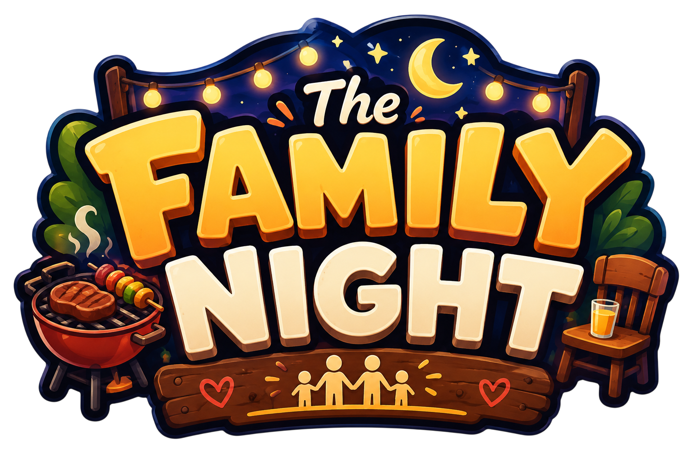

<p align="center">
  
</p>

# The Family Night

An Arcade (Python) story game with a bus shopping trip and cooking scenes.

## Run the Game

Use Python 3.12 with Arcade, Pillow, NumPy and SciPy installed.
PyAV enables animated backgrounds; without it the game uses still art.

Run the game from this folder:

    py -3.12 main.py --windowed

To start directly at the bus stop:

    py -3.12 main.py --bus --windowed

Bus controls: A/D to move, Space to jump, Enter beside the bus to board.
Bus events appear in random order at random intervals. The response letter changes each time. The central ALERT shows the event name, random letter, required presses and countdown. Warning icons have no fixed key labels.
Every five continuous seconds outside the circle costs one health segment.
Space or P pauses the ride. Arrival automatically continues to the BBQ scene.

## Layout

```
main.py                 entry point: opens the window, shows the menu
game/
  config.py             canvas size, asset paths, tuning, palette, credits
  art/                  pure Pillow image work, no arcade and no GL context
    keying.py           key_out_white, solid_bbox, trim
    spritesheet.py      band_cuts, slice_sheet, align_frames, load_terry_frames
    widgets.py          wood_fill, add_drop_shadow, draw_plank, draw_disc, draw_card
  textures.py           the only place PIL images become arcade textures; caches by pixel size
  backdrop.py           scene backgrounds: looping video in quality mode, the still otherwise
  sprites.py            Terry: walk, jump and idle states
  ui.py                 Stage, MenuButton, CreditsButton, Card
  views.py              StageView, MenuView, GameView
tools/
  fetch_icons.py        downloads and renders the menu icons, development time only
assets/
  sprites/ backgrounds/ ui/ characters/ icons/
UI.py                   earlier standalone HUD prototype, not part of the package
```

Import from the module that owns it, for example:

```python
from game.art.keying import key_out_white, trim   # image helpers, no window needed
from game import textures                         # cached arcade textures
from game.ui import Stage, Card                   # menu widgets
```

## How the drawing works

**One canvas, any window.** Everything is positioned in a fixed 1280x720
canvas. `ui.Stage` maps that canvas onto the real window, letterboxing to keep
the aspect ratio. Widgets ask the stage for pixel sizes and build their art at
that size, so the menu is sharp at any resolution instead of being drawn small
and scaled up. `StageView.on_resize` re-lays everything out.

**Sprite frames.** Terry's art is drawn on white paper, so `art.keying` removes
the background on a ramp (fully clear above 250, fully solid below 214) which
avoids a white fringe on the anti-aliased outline. The movement sheet's drawings
overflow an even grid, so `art.spritesheet.band_cuts` finds the cut lines from
the blank space instead of assuming a cell size. All frames end up on one canvas
with their feet on the bottom edge so the sprite never jumps or resizes.

**Menu furniture** (planks, medallion, parchment) is drawn procedurally in
Pillow at 4x and downsampled. `textures` caches each result by pixel size.

## Icons

`assets/icons/*.png` are generated from [Bootstrap Icons](https://icons.getbootstrap.com/)
(MIT). Only the PNGs are kept; the SVG sources are downloaded, rendered and
discarded by the tool:

```bash
python -m pip install cairosvg
python tools/fetch_icons.py
```

They are white silhouettes with an alpha channel, so the game tints one file for
both the resting and hovered colour. To change an icon, edit the `ICONS` table in
`tools/fetch_icons.py` and re-run it rather than editing a PNG. Attribution is in
`assets/icons/LICENSE.md`.

## Credits

Names shown in the in-game credits card live in `CREDITS_NAMES` in
`game/config.py`.

Bus UI ingredients: eggs, meat, cabbage and eggplant. The bread health bar has three segments.

## Bus tracking rings

The bus ride lasts 90 seconds. The mouse target alternates between a pirate
rag-doll ring and a metallic Tesla coil every 10–13 seconds, using a blue-white
light ripple and crossfade. Both rings are two-thirds of their original size.
Keep the mouse inside the glowing inner guide:

- The pirate gives a short cannon warning, fires a cannonball, then spins and
  recoils about 260–340 canvas pixels to a new position (at least 240 near edges).
  The ball is a visual recoil cue; health still depends
  on keeping the mouse inside the ring.
- The Tesla coil marks its destination, charges, stretches out of sight, and
  reappears along an electric trail with a landing pulse and a fading afterimage.
  The outside timer pauses during the part where the ring cannot be tracked.
- Outside the ring, the red guide breathes and asks you to move the mouse inside.
  Inside, the guide immediately becomes steady green. There is no periodic fire.
- Five continuous seconds outside a visible ring costs one bread segment.
  Pause/menu freezes movement, light effects, projectiles, and damage together.

Start directly in the bus ride for testing:

```powershell
py -3.12 main.py --bus-ride --windowed
```

Artwork is in `assets/ui/bus-scene/target-rings/`. The preparation script
`tools/prepare_bus_rings.py` accepts the original pirate, coil and flame images;
runtime animation uses fixed sprites and procedural movement/effects so that
the hit area stays aligned with the art. No additional dependencies are needed.
